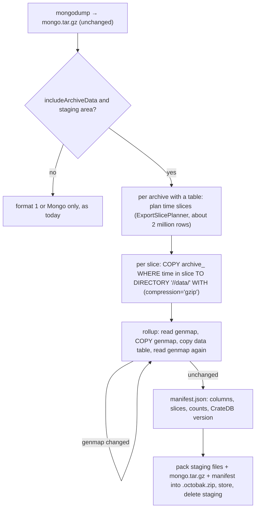

# Concept: Tenant Backup/Restore — archive data through COPY TO and COPY FROM

> Work item: **AB#5490** (Feature **AB#5967**, Epic **AB#3364**).
> Predecessors: **AB#4230** (archive data export/import), **AB#4231** (tenant backup with archive
> data, `concept-tenant-backup-archive-data.md`), **AB#5489** (export reads time slices).
> Status: **Concept complete; local implementation under way** (Feature AB#5967, step 1 of §12; the
> engine contract of slice AB#6967 is in §11). Decisions are in §3 and §12; §12 also lists what is
> still to be checked.

## §1 Goal

The tenant backup an operator starts from the Studio, the CLI or MCP (`Dump -iad`, `Restore -rad`)
takes and restores the archive data of a tenant at the speed CrateDB itself delivers, also for a
tenant with more than 100 million archive rows, and it carries everything a restore needs —
including the rollup generation pointers. The operator still gets one file to download and uploads
one file to restore. A backup taken on CrateDB 5.x restores on CrateDB 6.x.

This is the tenant backup, not disaster recovery: the nightly cluster-wide snapshots (AB#3865) are
a separate mechanism and stay as they are.

Targets (acceptance criteria of AB#5490), for a tenant with 115 million archive rows on a managed
environment:

| Step | Today | Target |
|------|-------|--------|
| Archive part of the dump | about 30 h before AB#5489; 45 min to 2 h estimated after it (never measured on a cluster) | at most 30 min |
| Archive part of the restore | 21 to 68 h (470 to 1,520 rows a second), tenant unusable for that time | at most 2 h |

The dump runs against a live tenant. The restore replaces the tenant, so the target tenant is
offline while it runs; the point is that this takes about an hour and a half, not days.

Out of scope: export and import of a single archive (AB#4230); the MongoDB part of the backup;
the cluster snapshots.

## §2 Why the current path is slow and incomplete

- **Rows travel through the bot service.** The dump reads every row over the PostgreSQL protocol,
  turns it into NDJSON and compresses it in the bot. Since AB#5489 that reaches 197,000 rows a
  second locally, about a third of what `COPY TO` does on the same machine. The restore parses
  every line and writes it back as `INSERT … ON CONFLICT` statements of 5,000 rows, one after
  another; this is the part that takes days.
- **The restore flattens rollup generations.** The import writes every rollup row with generation 0
  (AB#4773), and the generation map `archive_<rtId>__genmap` is in neither the dump nor the
  restore. A window that was recomputed can come back with the values of a superseded generation.
- **Backups lie on the bot pod's own disk.** On the managed environments the bot service has no
  volume and no artifact store configured. A backup of several gigabytes is held on the pod's
  ephemeral disk during dump and restore and is gone after a pod restart.
- **Size of the file.** The large tenant's backup is about 5.5 GB (3.4 GB MongoDB, 2.1 GB archive
  data). The restore upload accepts up to `Bot:MaxUploadSizeBytes`, 10 GiB by default (the 5 GiB
  named in the AB#4231 concept is no longer the limit).

What CrateDB does with its own bulk statements, measured on prod-2 (CrateDB 5.9.10, three nodes)
during the EC v2 migration (`energy-community/scripts/migration/ec-v2/15-export-stream-data.py`,
`16-import-stream-data.py`):

| Statement | Rate | 115 million raw rows |
|-----------|------|----------------------|
| `COPY TO` (gzip) | about 127,000 rows a second | about 15 min |
| `COPY FROM` (gzip, bulk table settings) | 35,000 to 38,000 rows a second | 55 min including the segment merge |
| all tables of the ladder (raw, five rollups, generation maps) | — | 88 min |

The scripts wrote to the disk of the CrateDB nodes and moved the files with `kubectl exec`. A
service cannot do that, which is what §5 solves.

## §3 Decisions

| # | Topic | Decision |
|---|-------|----------|
| 1 | Dump | `COPY TO`, issued by the bot service as SQL. The CrateDB nodes write the files themselves. |
| 2 | Restore | `COPY FROM`, issued by the bot service as SQL. The CrateDB nodes read the files themselves. |
| 3 | Where the files lie in between | A staging area in the platform artifact store of the environment (AB#5561), not in the disaster-recovery buckets (§5). No new service in the cluster. |
| 4 | File format | CrateDB's line-wise JSON (`json_object`), gzip. No snapshots, no storage files, nothing that depends on the CrateDB version (§9). |
| 5 | What the operator handles | One `.octobak.zip`, as today, `formatVersion: 2`. Download and upload through Studio, CLI and MCP are unchanged (§8). |
| 6 | Completeness | Every table of an archive is copied verbatim: the data table with its `generation` column and the generation map (§6). |
| 7 | Table definition | Never part of the backup. The restore creates every table through the platform's own DDL on the target cluster (§7, §9). |
| 8 | Without a staging area | The existing row path stays (format 1), so an installation without object storage keeps working at today's speed. |

Considered and not chosen: reading the rows through the bot for the dump (no storage needed, but a
third of the speed and above the 30 minutes on a cluster by estimate); `COPY FROM` over an HTTP URL
served by the bot (no storage needed for the restore, but a second mechanism next to the one the
dump needs anyway); a shared volume between CrateDB and the bot (the CrateDB operator cannot mount
one); letting the bot fetch files from the CrateDB pods (needs exec rights on the database pods).

## §4 Backup artifact, format 2

```
{tenantId}-{yyyyMMdd-HHmmss}-{guid}.octobak.zip
├── mongo.tar.gz                              # mongodump blob, verbatim (unchanged)
├── manifest.json                             # formatVersion 2
└── archives/
    └── <rtId>/
        ├── data/<slice>/<file>.json.gz       # COPY TO output of archive_<rtId>, one folder per time slice
        └── genmap/all/<file>.json.gz         # COPY TO output of archive_<rtId>__genmap (rollups only)
```

`manifest.json` adds to format 1, per archive: the tables with their columns and CrateDB data types
(read from `information_schema.columns` at dump time), the slices with their time range, the row
count counted before the copy and the count `COPY TO` reported; at the top level the CrateDB
version of the source cluster and the platform version. The schema block of format 1
(`ArchiveSchemaDto`) stays, so the schema match of AB#4230 §6 works unchanged.

Entries under `archives/` are stored without compression (they are gzip files). Building the
container is a byte copy from the staging area, and a restore hands each entry to the staging area
without unpacking it.

**Format 1 stays readable.** A backup taken before this change restores through the existing row
path, also on a cluster that has moved to CrateDB 6. The restore job already reads `formatVersion`
from the manifest; today it refuses everything but 1, and it will branch on 1 and 2.

## §5 Staging area

`COPY TO` and `COPY FROM` address a location, not a client connection: the node disk, an S3 bucket
or an Azure Blob container. The location must be reachable by every CrateDB node and by the bot.

**The staging area is the platform artifact store** (AB#5561, `secret-sweep-dump-storage.md`): one
object-storage target per environment for operational artifacts, apart from the disaster-recovery
buckets, with credentials that reach nothing else. The bot already keeps tenant dumps and restore
uploads there through `IArtifactStore` / `IBotArtifactStorage`; CrateDB writes to and reads from
the same store. Dump and restore can then neither fill nor damage the snapshot storage. Setting the
store up per environment (AB#5562 to AB#5565) is a precondition with stories of its own; this
feature adds the lifecycle entry for the new category (§11).

| Environment | Artifact store | `COPY` scheme |
|-------------|----------------|---------------|
| test-2 | bucket `test-2-octo-artifacts`, Hetzner Object Storage, project of its own | `s3://` |
| prod-1 | bucket `prod-1-octo-artifacts`, Exoscale SOS, IAM role of its own | `s3://` |
| staging-1 | storage account `mmstaging1artifacts`, container `octo-artifacts` | `az://` |
| prod-2 | storage account `meshmakersprod2artifacts`, container `octo-artifacts` | `az://` |
| local (kind) | S3-compatible store added to the local cluster (§10) | `s3://` |

Every managed environment runs CrateDB 5.9.10 with three nodes (read from the clusters on
2026-10-13). `COPY` supports Azure Blob since CrateDB 5.9.0 (release notes), with an account key or
a SAS token.

**Layout.** A new category `copy-staging` next to the existing ones (`presweep`, `tenant-dumps`,
`restore-staging`) holds the files of a running dump or restore under
`<instancePrefix>/copy-staging/<tenant>/<runId>/…`. It needs its own entry in the lifecycle rules
of each store (expiry after one day, the backstop behind the cleanup of the job itself).

| Provider | Statement location | Credential in the statement |
|----------|--------------------|-----------------------------|
| `AzureBlob` | `az://<account>.blob.core.windows.net/<container>/<prefix>/…` | `sas_token` in the `WITH` clause, issued by the bot for the run |
| `S3` | `s3://<key>:<secret>@<host>/<bucket>/<prefix>/…` | access key in the URI; a key limited to the platform's bucket |

- A run deletes its staging files at the end. The category has a short retention, so the files of
  a crashed run disappear by themselves.
- Staging files are not encrypted with the instance key ring: CrateDB has to read them. They exist
  for the length of a run. The finished `.octobak.zip` is encrypted as today, including its archive
  entries. On Azure and Exoscale the store encrypts at rest; Hetzner (test-2) does not, so staging
  files lie there in plain text for the length of a run. Accepted for test-2, which holds no
  customer data.
- A small type describes a staging location for CrateDB: the URI as CrateDB sees it plus the `WITH`
  options that carry the credential. The endpoint CrateDB uses can differ from the one the bot uses
  (local development, §10). The type, `ArchiveCopyStagingLocation`, lives in the engine
  (`Runtime.Contracts`, next to `IStreamDataRepository`, which takes it); `octo-common-services`
  builds it from the artifact store settings of the environment. The credential is reachable only
  through two methods that are named for it (`RevealUri`, `RevealOptions`); `ToString()`, every
  property and any serializer show the redacted form (`ArchiveCopyRedaction`: user info of the URI
  dropped, every `WITH` option masked unless it is on a short list known to be harmless), and
  `Scrub(text)` removes the credential from a text that may echo it, such as a driver error message.
  The bot never logs the credential; statement texts are logged with it removed.
- **`COPY` statements are kept out of `sys.jobs_log`.** CrateDB records every finished statement
  with its full text there, which for S3 includes the secret key. The cluster setting
  `stats.jobs_log_filter` is set to `stmt NOT ILIKE 'copy %'` (persistent), so `COPY` statements
  are not recorded; every other statement is, as before. The setting belongs to the set-up of the
  environment (§11) and of the local infrastructure (§10). The bot reads it before a run and does
  not use the staging area while the filter is missing. `stats.jobs_log_persistent_filter` stays
  at its default (`false`), so no statement text is written to the server log. While a `COPY`
  runs it is listed in `sys.jobs`; a database user sees only its own statements there and in
  `sys.jobs_log`, a superuser sees all.
- **The statement text must not leave the bot either.** Three places carry SQL text today and get
  a redacted text (URI without key, no `sas_token`) for `COPY`:
  `StreamDataStatementTimeoutException` puts the first 160 characters of the statement into its
  message, which for `COPY … FROM '<uri>'` includes the key; the `PostgresException` of the driver
  is passed on unchanged; and the pods run the injected OpenTelemetry auto-instrumentation, which
  can record the command text of the driver as a span attribute. `COPY` commands are therefore
  excluded from the driver's tracing (command filter of the Npgsql tracing options), and the
  repository raises its own exception with the redacted text. The services' own tracing does not
  subscribe to the driver, and their debug log lines with SQL text belong to the query paths only.
- **Finished backups move to the same storage.** With the artifact store configured, the bot keeps
  dumps and restore uploads there (existing categories `tenant-dumps`, `restore-staging`) instead
  of on the pod's disk. This is existing code that only needs configuration; the staging area
  needs the same configuration.

## §6 Dump



- **Slices.** One `COPY TO` per time slice, cut by `window_start` (or `timestamp` on a raw archive)
  with the planner AB#5489 introduced. A slice is a short statement, shows progress, and the job
  can stop between two slices.
- **The tenant stays online.** No archive is disabled. As today the dump is not a snapshot: a row
  written while it runs may or may not be part of it. Each slice is counted before the copy; a
  difference to the number `COPY TO` reports is recorded in the manifest and logged as a warning,
  not treated as a failure (expected in the open bucket of a live tenant).
- **Rollups and their generation map.** A recompute copies new rows, flips the pointer and sweeps
  the old generation. A dump that reads data and pointer on different sides of that flip would
  restore windows no reader can see. The dump (`IStreamDataRepository.DumpArchiveToStagingAsync`) reads
  the generation map, copies it, copies the data slices, and reads the map again; when the two reads
  differ it repeats that rollup (at most `ArchiveCopyOptions.MaxMapAttempts`, default 3, then it
  fails and names the rollup) — the pattern `RollupSourceBucketAggregator` already uses. The map is
  copied **first** and the data after it, and a load does the reverse (data first, map last): with
  the deferred sweep of a recompute (grace period, default 2 hours) the version the copied map
  names is still in the data when it is copied. The result states the number of attempts, the time
  of the map read and the time of the last data slice, so the caller can warn when the span is not
  well below the grace period. An archive that is not a rollup never reads or copies a map. Rollup
  tables are small next to the raw table.
- **Packing.** The bot streams the staging files into the container. For the large tenant that is
  about 2 GB from the storage through the bot.
- **Statements run as maintenance statements** (`CrateStatementClass.Maintenance`) with a command
  timeout of their own for the copy.

### Placement matrix: where a recompute can hit a dump

Measured with real recomputes against a real CrateDB (AB#6968; asset-repo integration tests, 34 cases, 18 s). Each cell gives the
defects found in the restored rollup, in this order: *empty windows / windows differing from the source at map-read time / orphan
rows above the pointer / pointers without rows*. "No flip" and "flip before the dump" are 0/0/0/0 in every column.

| Placement of the flip | Grace off, repeat off | Grace off, repeat on | Grace on, repeat off | Grace on, repeat on |
|---|---|---|---|---|
| between map copy and data copy | 6/0/1/1 | 2 attempts, 0/0/0/0 | 0/0/1/0 | 2 attempts, 0/0/0/0 |
| flip and sweep between map copy and data copy | 6/0/1/1 | 2 attempts, 0/0/0/0 | 0/0/1/0 | 2 attempts, 0/0/0/0 |
| flip after the data | 0/0/0/0 | 2 attempts, 0/0/0/0 | 0/0/0/0 | 2 attempts, 0/0/0/0 |
| flip and sweep after the data | 0/0/0/0 | 2 attempts, 0/0/0/0 | 0/0/0/0 | 2 attempts, 0/0/0/0 |
| flip after the dump | 0/0/0/0 | 1 attempt, 0/0/0/0 | 0/0/0/0 | 1 attempt, 0/0/0/0 |

The pass criterion is the column *grace on, repeat on*: all 0/0/0/0 and the validator ok. The grace period prevents the empty windows and the
pointer without rows: the sweep does not remove the generation the copied map names, so its rows are in the data copy. The repeat rule
catches the orphan rows of the new generation that the old map does not name, by copying the rollup again. "Flip after the data" also
repeats, because the second read of the map sees the moved pointer even though the files were consistent; a repeat costs time, not
correctness. Test classes `PlacementMatrixGraceOffTests` and `PlacementMatrixGraceOnTests` (`PlacementMatrixCases.cs`) in
`octo-asset-repo-services/tests/AssetRepositoryServices.IntegrationTests/StreamData`; run them with
`dotnet test -c DebugL --filter "FullyQualifiedName~PlacementMatrix"` (Docker needed, see the README of that test project). The
engine seams they use are `ArchiveCopyOptions.PhaseObserver` and `RepeatOnMovedMap`.

## §7 Restore

**Before the MongoDB restore: check that the storage can load.** The restore job asks the cluster, not a tenant,
whether the native copy can run (`IStreamDataRepositoryFactory.CheckStagingCopyReadinessAsync`, the cluster-level
member of the readiness check in the contract table below) and stops with the reason when it cannot, so a missing job
log filter leaves the tenant exactly as it was. The question must not build a tenant context: that would load the CK
cache from the database that the restore is about to replace. The answer is the same `StagingCopyReadiness` the
tenant-bound `IStreamDataRepository.CheckStagingCopyReadinessAsync` gives (both delegate to one piece of code), and
asking changes nothing in the cluster.

**Order of the archives: every source before the rollups that read it** (raw archives first, then rollups by the length of their source
chain). A rollup can be activated only while its source is `Activated`, and the dump lists the archives in no dependency order. A source
that was not `Activated` in the backup but has rollups stays `Activated` - with the restore reconcile marker set, which keeps forward
aggregation and recompute away from the tenant - until those rollups are restored, and is set back to `Disabled` at the end.

Per archive of the manifest that exists after the MongoDB restore and passes the schema match:

1. Disable, drop the table and its generation map, activate (the platform creates both tables with
   its current DDL), disable — the sequence of AB#4231 §5.1.
2. Check before loading: the columns of the dumped table against the columns of the new table
   (`information_schema.columns`); free disk space per node against the expected size (a table
   takes about nine times its gzip size right after the load and six and a half times after the
   merge).
3. Set bulk table settings (`number_of_replicas = 0`, `refresh_interval = 0`) and remember the
   previous values.
4. Put the archive's files into the staging area and run one `COPY FROM … RETURN SUMMARY` per
   slice. A slice counts as loaded when `success_count` equals the row count in the manifest and
   `error_count` is 0. A repeated slice uses `overwrite_duplicates = true`.
5. Load the generation map the same way.
6. Restore the table settings (also when the load failed), merge the segments
   (`OPTIMIZE … max_num_segments = 1`, can be switched off), refresh, compare the table's row count
   with the manifest.
7. Restore the archive's backed-up status (enable only what was Activated), as today.
8. **Reconcile the rollups of the tenant** (AB#6968), once all archives of the tenant are loaded: set the marker
   *restore reconcile pending* (`SetRestoreReconcilePendingAsync(true)`; it stays set until step 11), run the validator, repair, validate again.
   The restore result carries both reports.
9. `ValidateRollupsAsync`: a pointer entry whose generation has no rows **where a source holds rows in that range** (an entry over a range the
   source is empty in is a correct empty recompute or backfill, not a finding; a rollup source counts only the rows live under its own pointer),
   rows above every covering pointer entry, a watermark ahead of the
   last rollup row while a source holds rows in between, a rollup without its generation map. Read only, counts and MIN/MAX. A rollup that cannot
   be looked at (no table, a source missing) is reported as *not checked* with the reason and makes the report not ok; "nothing
   found" never means "not looked at". The repair skips such a rollup and the marker stays set. A rollup that was never activated is listed
   too, for information only: it has no data, so it neither makes the report not ok nor keeps the marker.
10. `RepairRollupsAsync` (skipped when the validator reports ok): create the map, delete the orphans, recompute only the ranges that have
    no rows, rewind a watermark that is ahead of the rows (the forward aggregation fills the gap). A dry run lists the steps.
11. When the second validation is ok the repair clears the marker; a failing repair names the failing step and **leaves the marker set**.
    The marker is also kept while an archive of the backup failed to restore (the job knows the manifest, the validator does not), a repair of
    only some rollups clears it only when the whole tenant validates ok, and deleting a tenant removes the marker, the repair queue rows and
    the sweep records together with the archive tables (`IStreamDataRepositoryFactory.DeleteTenantStateAsync`; the shared schema keeps a
    neighbour tenant's rows), so a tenant created again under the same id starts without a marker.

While the marker is set the tenant's rollups are not aggregated further, recomputed or swept (the host skips the tenant, a direct call is
refused with `RestoreReconcilePendingException`); everything that reads works. A tenant and a backup without the marker (everything made
before this feature) are not affected. A backup of format 1 carries no generation map: its rollup rows are loaded as they are and
the reconcile step brings them in line (see the repair for what is removed as orphans).

**NULL in a column that has a DEFAULT is not preserved.** `COPY TO` leaves NULL values out of the
line and `COPY FROM` applies the column default to a missing value, so a NULL
`rtcreationdatetime` or `rtchangeddatetime` comes back as the time of the load. This is accepted:
a column with a default is not meant to hold NULL, and the platform never writes one. Columns
without a default keep their NULL.

A failed archive is reported and the job continues with the next one (decision 4 of AB#4231). The
rollup tables come back row for row, so no rollup has to be recomputed after a restore - unless the validator of step 8 finds the
rollup inconsistent (a dump taken while a recompute ran, a backup of format 1, a lost map), in which case the repair recomputes exactly the
affected ranges.

Restore under another tenant id and on another environment works as today: the files hold no tenant
id, and the target schema and table names are derived from the target tenant. The two environments
need not use the same kind of storage; the backup file is what travels.

## §8 What the operator sees

Nothing changes in the commands and dialogs.

- **Dump:** `Dump -iad` in the CLI, the checkbox in the Studio, `dump_tenant` in MCP. The job
  result names one `.octobak.zip`; the existing download endpoint delivers it.
- **Restore:** upload of the `.octobak.zip` and `Restore -rad` as today; the format is detected.
- **Sizes:** the file of the large tenant is about 5.5 GB, inside the upload limit of 10 GiB
  (`Bot:MaxUploadSizeBytes`, configurable per environment). The SDK uploads `Restore` and
  `ImportArchiveData` resumable in parts (tus) of 50 MiB by default. The part size is configurable
  in the SDK from 1 to 90 MiB, because the request size limit of the ingress is 100m; `octo-cli` has
  `-ps` / `--part-size-mib` for both commands, MCP uses the default through the SDK. A refused part
  is reported with its status, part number and offset and without file content, and an interrupted
  upload resumes from the server's offset.
- **Which path ran** is in the job log and in the manifest (`formatVersion`).

## §9 CrateDB versions

**The feature runs on the deployed 5.9.10.** `COPY TO` / `COPY FROM` with gzip, `RETURN SUMMARY`
and `overwrite_duplicates` were used on prod-2 under 5.9.10; S3 as a location is long-standing,
Azure Blob came with 5.9.0. The minimum 5.10.1 that the 6.0 release notes name concerns the rolling
upgrade of a cluster, not `COPY`.

**A backup from 5.x restores on 6.x** because nothing in it belongs to a CrateDB version:

- **Data is text.** Line-wise JSON with gzip is the documented exchange format of `COPY TO` /
  `COPY FROM`. The 6.0.0 release notes name exactly this pair as the way to re-create tables the
  new version can no longer read.
- **No table definition travels.** The target cluster creates the tables with the DDL of the
  platform version it runs, in its own storage format. Shards, replicas and index settings are the
  target's.
- **No snapshot is involved.** A snapshot is tied to the storage format.
- **The manifest records the source version.** The restore logs source and target version. It does
  not refuse a difference; it refuses a column that the target table does not have.

Checked against the 6.0.0 release notes: no breaking change touches `COPY FROM`, `COPY TO` or the
column types archives use. The same holds for the notes of 6.1.0 to 6.4.0. Three points of those
notes concern the upgrade of a cluster and the row path, not this feature, and belong to the
upgrade work (AB#6651): 6.1 to 6.3 can lose the data of tables created before 5.5.0 (fixed in
6.1.4, 6.2.6 and 6.3.2); since 6.2 a write to a system column is an error instead of being
ignored; since 6.4 implicit casts of `INSERT` are checked the same way for one and for many rows.

Tried locally with the 145 million rows of the large tenant, 5.10.10 to 6.4.6: identical data
(§12).

**To be proven by a test** (integration test with CrateDB containers per version: dump on 5.9.10
and 5.10.x, restore on the current 6.x; comparison per series by row count and column aggregates,
as script `16` does):

- every column type an archive can have, including object and array columns of record attributes;
- a NULL in a column without a DEFAULT comes back as NULL (a NULL in a column that has a DEFAULT
  is not preserved, §7);
- timestamps to the millisecond and doubles without loss;
- a rollup with a recomputed range: same values through the read path before and after;
- a format 1 backup taken on 5.x restores on 6.x through the row path.

The direction 6.x to 5.x is not promised.

## §10 Local development

The local stack is a kind cluster with one CrateDB node (5.10.10 at the time of writing), MongoDB
and RabbitMQ in the namespace `octo-infra`; the services run as processes on the developer machine.
There is no object storage, and the bot process cannot see the disk of the CrateDB pod.

- An S3-compatible store is added to `octo-infra` as one more pod with a host port. The local stack
  then runs the same code path as test-2 and prod-1.
- The bot reaches the store through the host port, CrateDB through the cluster name. The staging
  location therefore has two endpoints: the bot's and the one CrateDB sees.
- The local infrastructure sets the job log filter of §5 on its CrateDB node together with the
  store.
- Without the store the local stack uses the row path (format 1), like any installation without
  object storage.
- The Azure path is not reproduced locally; it is verified on staging-1.

## §11 Where the change lands

| Repository | Change |
|------------|--------|
| `octo-construction-kit-engine` | Contract on `IStreamDataRepository` (AB#5967, slice AB#6967): copy an archive's tables to and from a staging location, with slice results. This document. See "The engine contract" below. |
| `octo-construction-kit-engine-mongodb` | CrateDB implementation: slice planning, `COPY` statements, summary evaluation, bulk settings, generation map handling, column and disk checks. |
| `octo-common-services` | Artifact category `copy-staging`; builds the engine's `ArchiveCopyStagingLocation` per provider (SAS token, S3 key, endpoint as CrateDB sees it) from the artifact store settings. |
| `octo-bot-services` | `DumpRepositoryJob` and `RestoreRepositoryJob`: format 2 writer and reader, format 1 kept; restore upload limit. |
| `octo-asset-repo-services` | Integration tests against CrateDB (version matrix of §9). |
| `octo-tools` | S3-compatible store in the local kind infrastructure. |
| deployment (`meshmakers-infrastructure`, `octo-mesh-deployment`) | Artifact store per environment (AB#5562 to AB#5565, prepared, not applied yet); lifecycle entry for `copy-staging`; artifact store settings of the bot service. |

SDK, CLI, MCP and Studio need no change.

### The engine contract

All types are in `Meshmakers.Octo.Runtime.Contracts.StreamData`. The members of `IStreamDataRepository`
have default implementations, so a repository without a staging area (and every existing implementer)
stays valid.

| Member | Meaning |
|--------|---------|
| `CheckStagingCopyReadinessAsync` | Preflight, **read only**: `StagingCopyReadiness(Supported, JobLogFilterSet, StorageVersion, Reason)`, `IsReady` = supported and the filter of §5 is set. A missing prerequisite is the answer (with a reason that says what to set, never a credential), not an exception. Two doors, one answer: on `IStreamDataRepository` (tenant-bound) and on `IStreamDataRepositoryFactory` (engine-mongodb contracts; cluster-level, needs no tenant, no CK cache and no archive store, so a restore can ask before it touches the tenant). |
| `SupportsStagingCopy` | `false` unless the repository implements the copy. When `false`, the caller takes the row path (format 1) and the members below throw `ArchiveCopyNotSupportedException`. |
| `PlanArchiveCopyAsync` | Cuts an archive into counted, ascending `ArchiveCopySlice`s (the generation map of a rollup last) and describes every table. The result is the `ArchiveCopyPlan` the bot writes into the manifest. |
| `CopyToStagingAsync` | Dumps the slices of a plan one at a time into `<rtId>/data/<slice>/` (`<rtId>/genmap/all/`) and yields an `ArchiveCopySliceResult` per slice. Ends after the first failed slice, stops between slices on cancellation, refuses while the job log filter of §5 is missing. |
| `CopyFromStagingAsync` | Loads the slices of a plan into the freshly created tables, same shape as the dump; checks columns and disk before the first slice, restores the bulk table settings when the enumeration ends, optionally merges at the end (`ArchiveCopyOptions`). Reads the files of the plan's archive id, so a restore into another archive id works. |
| `DescribeArchiveTableAsync`, `GetStorageVersionAsync` | Columns with their data types, and the version of the data store, for the manifest. |
| `DumpArchiveToStagingAsync` | Dumps one archive completely and applies the repeat rule of §6: for a rollup the generation map is read, copied, the data slices are copied, the map is read again, and the whole rollup is copied again when the map moved in between (up to `ArchiveCopyOptions.MaxMapAttempts` times). The result states the attempts and the times of the map read and of the last data slice. An archive without a generation map is copied once. |
| `LoadArchiveFromStagingAsync` | Loads one archive from a plan (data slices first, the generation map last) with the checks, bulk settings and refusals of `CopyFromStagingAsync`, and states whether the tables hold exactly the counted rows (`ArchiveCopyLoadResult.RowCountVerified`). |
| `SweepSupersededGenerationsAsync` | Runs the deferred sweeps of recomputed rollup ranges that are due (the sweep grace period of §6). A recompute records the sweep of the superseded generation durably instead of running it at once; this call executes every record whose flip time plus grace period has passed, also after a restart, and returns the number of sweeps executed or dropped as obsolete. A repository that defers nothing returns 0. |
| `ValidateRollupsAsync` | Read only check of rollups for what a restore, or a dump taken during a recompute, can leave (`RollupConsistencyCheck`): a pointer without rows, rows above the pointer, a watermark ahead of the rows, a missing generation map. A rollup that cannot be checked is listed as `NotChecked` and makes `RollupConsistencyReport.IsOk` false; a never activated rollup is listed as information only (§7). |
| `RepairRollupsAsync` | Validates, repairs what the validator found and validates again (`RollupRepairReport`); idempotent, with a dry run that lists the steps and changes nothing. The restore reconcile marker is cleared only when the final validation is ok. |
| `EnqueueRollupRepairAsync`, `GetRollupRepairRequestAsync` | Queue a repair durably instead of running it under the caller (for REST, CLI and MCP), and read its state and report (`RollupRepairRequest`, `RollupRepairRequestState`). |
| `RunPendingRollupRepairsAsync` | Runs the queued repairs of the tenant that are pending, or were left running by a process that died; called by the host's recompute tick. |
| `IsRestoreReconcilePendingAsync`, `SetRestoreReconcilePendingAsync` | The durable *restore reconcile pending* marker (§7): while it is set, reclaim, forward aggregation and recompute do not run for the tenant. An absent marker means not pending, so tenants and backups from before this feature work unchanged. |

A slice result carries the counted rows (`Slice.RowCount`), the copied rows, rejected rows, the duration
and a **redacted** message. A refusal before any data moved is `ArchiveCopyRefusedException` with a
reason (`JobLogNotFiltered`, `ColumnMissing`, `InsufficientDiskSpace`, `GenerationMapKeptMoving`). Plan,
slice and result records round-trip through System.Text.Json. Tests:
`Runtime.Engine.Tests/StreamData/ArchiveCopy*Tests.cs` and `RollupConsistencyContractTests.cs`; the
in-memory fake that drives the dump and load order is `FakeStagingCopyStreamDataRepository`.

### Setting up the artifact store per environment

A precondition of this feature, rolled out with its own stories (AB#5562 test-2, AB#5563
staging-1, AB#5564 prod-1, AB#5565 prod-2) by their owner. This feature starts when that rollout
is finished, and adds two things to it: the lifecycle entry for `copy-staging` (step 1) and the
job log filter (step 5). Terraform and Ansible for the store exist in `meshmakers-infrastructure`
behind a switch that is off; no cluster runs the store yet. Per environment, in the order test-2,
staging-1, prod-1, prod-2:

1. Add the lifecycle entry for `copy-staging` to the Terraform of the store.
2. Apply Terraform: bucket or storage account with its lifecycle rules.
3. Create the credential and put it into Vault. A person does this; agents neither read nor write
   the secret values.
4. Roll out the Kubernetes secret and set the artifact store values of the bot service.
5. Set the job log filter on the CrateDB cluster (`stats.jobs_log_filter`, §5).
6. Verify: a tenant dump survives a restart of the bot pod, the cleanup removes it after the
   retention, the credential reaches nothing in the disaster-recovery storage, and a `COPY`
   statement leaves no entry in `sys.jobs_log`.

Every step on an environment needs the operator's go for that environment. The same store serves
the secret dumps of AB#5539, so the set-up is coordinated with that work.

## §12 Order of work and open points

**Order** (starts when the artifact store is rolled out, decision 8)

1. Local store in the kind infrastructure; engine contract and CrateDB implementation; dump and
   restore of the local 115 million row copy, with the row path as the baseline. No measurement on
   a production environment.
2. Format 2 in the dump and restore jobs; version test of §9.
3. Lifecycle entry and job log filter on test-2 (S3) and staging-1 (Azure Blob); the Azure path is
   verified there.
4. Run with a tenant of the large size on a managed environment; environment and time are the
   operator's decision. Figures recorded in AB#5490.
5. Lifecycle entry and job log filter on prod-1 and prod-2.

**Local trial, 2026-10-13** (kind cluster, SeaweedFS 4.48 as the S3 store, addressed by cluster
name and port without TLS; CrateDB 5.9.10 and 5.10.10, each a single node)

| Question | Result |
|----------|--------|
| `COPY TO` / `COPY FROM` against an S3 store with its own host and port | Works on 5.9.10 and 5.10.10 with `protocol = 'http'`. The store needs an access key configured; anonymous signed requests are refused. |
| Rate through the store (hourly rollup of the large tenant, 28,819,666 rows, 5.10.10) | `COPY TO` 42 s (about 690,000 rows a second), `COPY FROM` 185 s with bulk table settings (about 156,000 rows a second), no error rows. The files take 0.65 GB; the loaded table 5.9 GB before the segment merge against 2.7 GB at the source. |
| Rollup with recomputed ranges | Table and generation map come back identical: 16 generations with the same row counts, sums and time bounds, 16 identical pointer entries. |
| NULL in a column that has a DEFAULT | **Not preserved.** `COPY TO` leaves NULL values out of the line, and `COPY FROM` then applies the default: a NULL `rtcreationdatetime` or `rtchangeddatetime` comes back as the time of the load. Columns without a default keep their NULL. The archive tables of the large tenant hold no NULL in any column. |
| Credential in the statement | **Readable.** `sys.jobs_log` shows the full `COPY` statement including the S3 secret key on both versions. |
| Job log filter (5.9.10) | With `stats.jobs_log_filter` set to `stmt NOT ILIKE 'copy %'`, a `COPY TO` against the store leaves no entry in `sys.jobs_log`; the other statements of the same session are recorded. |
| Who can read the job tables (5.9.10) | A second database user with read access to `sys` sees only its own entries in `sys.jobs` and `sys.jobs_log`, none of the superuser's. |

Full run with the local copy of the large tenant (CrateDB 5.10.10, single node; raw archive, five
rollups and their generation maps, 145,520,476 rows in 11 tables, 86 time slices of about 2 million
rows):

| Step | Time | Rate |
|------|------|------|
| Dump (`COPY TO`, all tables) | 3 min 39 s | about 660,000 rows a second; raw archive alone 2 min 54 s |
| Restore, load (`COPY FROM`, bulk table settings) | 11 min 35 s | about 200,000 rows a second, no error rows |
| Restore, segment merge (`OPTIMIZE`) | 7 min 40 s | — |
| Restore in all | 19 min 15 s | — |

Every slice wrote and loaded exactly the counted number of rows. Source and copy agree in every
table (row counts, sums and time bounds per month or per generation; pointer entries of every
generation map). The files take 2.8 GB in the store; the copy takes 11.5 GB after the merge against
11.9 GB at the source. For comparison, the row export through the bot took 9 min 45 s for the raw
archive on the same machine.

Restore of that dump on a newer version (taken on 5.10.10, loaded into CrateDB 6.4.6, single node,
same store, tables created with the DDL the 5.10.10 node reports):

| Step | Result |
|------|--------|
| Table definitions | Accepted unchanged by 6.4.6 for all 11 tables. |
| Load (`COPY FROM`) and segment merge | 15 min 18 s in all; raw archive 451 s load (about 256,000 rows a second) and 338 s merge; no error rows, every slice loaded the counted number of rows. |
| Comparison with the source on 5.10.10 | Identical in every table (row counts, sums and time bounds per month or per generation; pointer entries of every generation map). |
| Job log filter | No `COPY` entry in `sys.jobs_log` on 6.4.6 with the filter set. |
| Disk use | 26.8 GB on 6.4.6 against 11.5 GB for the same data on 5.10.10, each with one segment per shard (raw archive 22.0 GB against 9.4 GB). The cause is not examined. |

Consequences:

- The disk check before a restore (§7) takes its factors from the target version; the figures of
  §7 are those of 5.10.10. The larger disk use on 6.4.6 concerns every table after the upgrade and
  belongs to the upgrade work (AB#6651).

- NULL in a column that has a DEFAULT: accepted, no handling in dump or restore (§7, decision 6).
- The S3 key must not stay readable: `COPY` statements are filtered out of `sys.jobs_log` (§5,
  decision 7).

**Still to check**

- `COPY` with `az://` against an Azure container under 5.9.10 (on staging-1).
- Whether the injected auto-instrumentation records the driver's command text on the environments
  (not visible locally; §5 excludes `COPY` from it either way).
- The 50 MiB default part size of the upload (§8) is confirmed on staging-1 at acceptance (AB#5490);
  that needs Gerald's go for the environment.
- The rates on a three-node cluster with replicas; the local figures come from a single node.

**Decisions on the points that were open**

1. **Credentials — decided:** one dedicated credential set per environment, limited to the
   artifact store and kept in Vault (design decision on AB#5490, 2026-10-13); the keys of the
   disaster-recovery jobs are not shared. Bot and CrateDB use the same credential set. S3: the key
   is part of the statement text. Azure: a SAS token issued by the bot for the run (the artifact
   store concept avoids SAS URLs as a way to hand out the secret dumps; a token passed to CrateDB
   for one run is a different use). To check early: no credential in `sys.jobs_log`, the tracing
   backend, API responses or CLI and Studio output.
2. **Restore without upload — decided: not in scope.** Naming a backup that already lies in the
   artifact store instead of uploading it helps only inside one environment; it stays a possible
   later extension.
3. **Consistent dump on request — decided: no option.** The dump stays online and is not a point
   in time. An operator who needs an exact state stops the tenant's data intake (adapter,
   reception) before the dump; the documentation says so.
4. **Which store locally — decided:** SeaweedFS as the first candidate, tried against the local
   CrateDB in the first step of the work; Garage as the second. The automated tests need no store:
   a single CrateDB container reads and writes `file://` in its own file system.
5. **Retention of finished backups — decided: unchanged.** A finished backup is not removed by its
   download; the hourly cleanup deletes it after `Bot:ArtifactRetentionHours` (24 hours,
   configurable per environment). No command to delete one earlier. An operator who needs a
   backup for longer downloads it. Capacity is not a limit: blob and S3 storage are billed by use.
6. **NULL in a column that has a DEFAULT — decided: accepted.** The restore does not bring such a
   NULL back; the column holds the time of the load. No count in the manifest, no correction after
   the load. Tables with a default are not meant to hold NULL in that column.
7. **Credential in the job log — decided: filter.** `COPY` statements are kept out of
   `sys.jobs_log` through `stats.jobs_log_filter` (§5).
8. **Schedule — decided: on hold after the concept.** The concept is worked out to the end and
   verified locally as far as possible; the implementation starts when the artifact store is
   rolled out to the environments (AB#5562 to AB#5565, §11).

Not part of this concept, seen on the way: the dump lock is shared by all tenants and a running
dump cannot be cancelled; the MongoDB dump and restore have a fixed limit of one hour.
